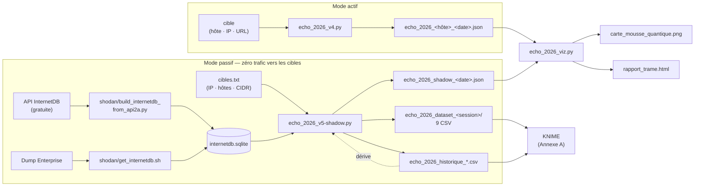
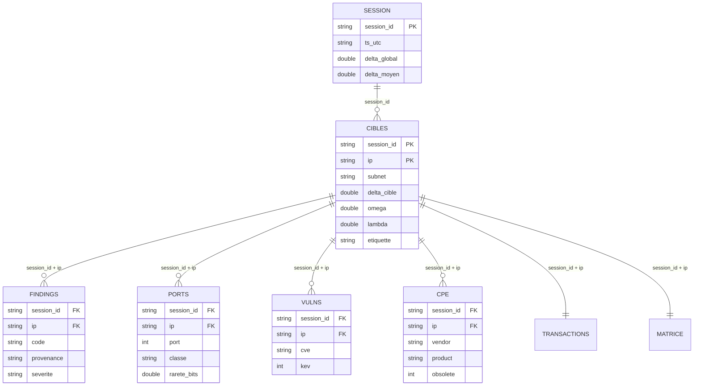

<div align="center">

# ✦ ECHO-2026 ✦

### Trame Réelle · Sonde Ontologique

**Un détecteur d'anomalies qui regarde l'Internet tel qu'il est, ou tel que sa mémoire l'a gravé, et le lit tel que la Trame le rêve.**


<sub>« La même IP ne produit jamais le même écho — elle produit le même spectre.<br>L'écho, lui, dépend de qui écoute, et de quand. » — *Codex Vauvillensis, Fr. XII*</sub>

</div>

---

## Sommaire

1. [Le principe](#le-principe)
2. [Vue d'ensemble](#vue-densemble)
3. [Le dépôt](#le-dépôt)
4. [Installation](#installation)
5. [Démarrage rapide](#démarrage-rapide)
6. [`echo_2026_v4.py` — le scanner actif](#echo_2026_v4py--le-scanner-actif)
7. [`echo_2026_v5-shadow.py` — la sonde passive](#echo_2026_v5-shadowpy--la-sonde-passive)
8. [`shodan/` — fabriquer la base InternetDB](#shodan--fabriquer-la-base-internetdb)
9. [`echo_2026_viz.py` — la cartographie](#echo_2026_vizpy--la-cartographie)
10. [`Grimoire-Echo.md` — le catalogue narratif](#grimoire-echomd--le-catalogue-narratif)
11. [Éthique et usage responsable](#éthique-et-usage-responsable)
12. [Limites connues](#limites-connues)
13. [**Annexe A — Exploiter le dataset avec KNIME**](#annexe-a--exploiter-le-dataset-avec-knime)

---

## Le principe

ECHO-2026 détecte des anomalies sur des cibles Internet (hôtes, IP, plages CIDR), puis superpose à chacune sa **lecture Trame** : une phrase issue du lore du projet.

```text
  haute    [MESURÉ] HTTP   Last-Modified dans le futur : 2029-06-06T12:00:00+00:00
           ↳ Un fichier se souvient d'un jour qui n'a pas eu lieu : écho rétrocausal.
```

Deux façons de regarder, complémentaires :

| Mode | Script | Ce qu'il fait | Trafic vers la cible |
|:--|:--|:--|:-:|
| **Actif** | `echo_2026_v4.py` | Observe réellement une cible : DNS, HTTP, TLS, TCP, RSS | oui (léger) |
| **Passif** | `echo_2026_v5-shadow.py` | Interroge un **cache Shodan InternetDB** (SQLite, lecture seule) et vérifie sa cohérence interne | **aucun** |

> **La frontière est abolie à l'affichage, jamais dans les données.**
> Fiction et réalité cohabitent sur la même ligne, mais chaque entrée porte une étiquette de provenance, et les scores ne comptent que ce qui est établi.

| Provenance | Signification | Intervient dans |
|:--|:--|:-:|
| 🟢 **MESURÉ** | Établi par une source : une observation réseau (v4) ou une affirmation du cache (v5) | **Δ** |
| 🟡 **CALCULÉ** | Déduit des mesures : incohérences, valeurs aberrantes, dérive, résonances numériques | **Ω** (v5) |
| 🟣 **LORE** | Fiction pure : « ports fantômes » calculés depuis l'arithmétique d'une IP | **Λ** (v5) |

> ⚠ **Nuance v5.** En mode passif, « MESURÉ » désigne *ce que le cache affirme* (ports, CVE, tags), pas une mesure faite aujourd'hui. Un cache peut avoir plusieurs jours de retard.

---

## Vue d'ensemble



---

## Le dépôt

```text
Echo-2026/
├── echo_2026_v4.py                      # scanner ACTIF : DNS, HTTP, TLS, TCP, RSS → JSON
├── echo_2026_v5-shadow.py               # sonde PASSIVE : cache SQLite → JSON + dataset KNIME + historique
├── echo_2026_viz.py                     # cartographie : JSON → carte 2D (PNG) + dashboard HTML
├── Grimoire-Echo.md                     # catalogue narratif des anomalies (couches v4)
├── README.md
└── shodan/
    ├── get_internetdb.sh                # télécharge le dump InternetDB (offre Enterprise)
    └── build_internetdb_from_api2a.py   # plan B gratuit : construit la base depuis l'API publique
```

| Fichier | Rôle | Lignes |
|:--|:--|:-:|
| `echo_2026_v4.py` | Observation réseau réelle d'une cible | ~670 |
| `echo_2026_v5-shadow.py` | Analyse passive, scores Δ·Ω·Λ, export dataset | ~1 330 |
| `echo_2026_viz.py` | Réduction de dimension et dashboard | ~500 |
| `shodan/get_internetdb.sh` | Récupération du dump (atomique, ancien conservé en `.prev`) | ~90 |
| `shodan/build_internetdb_from_api2a.py` | Collecte IP par IP depuis `internetdb.shodan.io` | ~290 |

Les JSON produits par `v4` et `v5-shadow` partagent un même contrat (`findings` + `delta` + `timestamp`) : **`echo_2026_viz.py` lit indifféremment les deux.**

---

## Installation

```bash
git clone https://github.com/V-Demon/Echo-2026.git
cd Echo-2026
```

| Besoin | Paquets | Obligatoire ? |
|:--|:--|:-:|
| Scanner v4, sonde v5, builder API | *aucun* (bibliothèque standard) | — |
| Couche RSS de v4 | `feedparser` | optionnel |
| Isolation Forest de v5 (lots ≥ 30 cibles) | `scikit-learn` | optionnel |
| Export Parquet de v5 (`--parquet`) | `pandas` `pyarrow` | optionnel |
| Cartographie | `scikit-learn` `matplotlib` `umap-learn` `plotly` | optionnel (dégradation gracieuse) |
| Dump Enterprise (`get_internetdb.sh`) | CLI `shodan`, `bzip2`, compte **Enterprise** | selon plan |

```bash
pip install feedparser scikit-learn matplotlib umap-learn plotly pandas pyarrow
```

Python **3.9+** recommandé. Attention : `echo_2026_v4.py` et `echo_2026_viz.py` écrivent leurs fichiers dans le **répertoire courant** (JSON, baseline `.echo_baseline.json`, PNG, HTML) ; seule la sonde v5 dispose d'une option `--out`.

---

## Démarrage rapide

### A. Sonde passive, sans compte payant *(parcours recommandé)*

```bash
# 1. Lister les IP à étudier (IP, hostnames ou CIDR, '#' = commentaire)
printf '8.8.8.8\n1.1.1.1\n# un /28 entier\n203.0.113.0/28\n' > cibles.txt

# 2. Construire le cache depuis l'API gratuite (Shodan voit la liste des IP)
python shodan/build_internetdb_from_api2a.py --targets cibles.txt --db internetdb.sqlite

# 3. Lancer la sonde — aucun paquet n'est envoyé aux cibles
python echo_2026_v5-shadow.py --db internetdb.sqlite --targets cibles.txt --no-dns --out scans/

# 4. Cartographier
python echo_2026_viz.py --input scans/ --offline
```

### B. Scan actif d'une cible qui vous appartient

```bash
python echo_2026_v4.py --target example.com
python echo_2026_v4.py --target mon-serveur.tld --authorized --ports 22,80,443
python echo_2026_viz.py --input . --offline
```

### C. Fouiller les données

Ouvrir `scans/echo_2026_dataset_<session>/` dans KNIME → [**Annexe A**](#annexe-a--exploiter-le-dataset-avec-knime).

---

## `echo_2026_v4.py` — le scanner actif

Effectue de **vraies observations** (DNS, HTTP, TLS, TCP, flux RSS), repère ce qui cloche, annote.

### Couches d'observation

| Couche | Ce qui est mesuré | Anomalies détectées |
|:--|:--|:--|
| **DNS** | Résolution A/AAAA | Nom public résolvant vers une adresse non publique (indice de *DNS rebinding*) |
| **HTTP** | `HEAD`, redirections suivies et validées **saut par saut** | `Last-Modified` futur, antérieur à 1995 ou postérieur à `Date` ; dérive d'horloge ; redirection vers l'intérieur ; downgrade HTTPS → HTTP ; version exposée (`Server`, `X-Powered-By`) ; HSTS absent |
| **TLS** | Chaîne, protocole, empreinte SHA-256 | Vérification échouée, certificat expiré, pas encore valide, expiration imminente, protocole obsolète, validité supérieure au plafond **CA/B SC-081v3** (398 j, puis **200 j** pour les certificats émis depuis le 15 mars 2026) |
| **TCP** | Connexion sur une courte liste de ports | Ports ouverts, ports à risque exposés (21, 23, 445, 3306, 3389, 5432, 6379, 9200, 27017) |
| **RSS** | Flux d'actualité configurés | Articles datés du futur, flux illisibles ou vides |
| **DIFF** | Comparaison à la baseline | Nouvelle IP, nouveau port, certificat ou émetteur changé, en-tête `Server` modifié |

> Le sondage **TCP est désactivé par défaut** et exige `--authorized`. Ports par défaut : 21, 22, 23, 25, 80, 110, 143, 443, 445, 3306, 3389, 5432, 6379, 8080, 8443, 9200, 27017.

### Usage

```bash
python echo_2026_v4.py --target example.com                    # scan passif d'une cible publique
python echo_2026_v4.py --target https://example.com/           # sous forme d'URL
python echo_2026_v4.py --target 203.0.113.7                    # ou d'IP
python echo_2026_v4.py --target mon-serveur.tld --authorized --ports 22,80,443,8080   # + sondage TCP
python echo_2026_v4.py --target example.com --update-baseline  # figer la baseline
python echo_2026_v4.py --target example.com --pur              # rapport technique pur
python echo_2026_v4.py --target http://127.0.0.1:8080 --allow-private   # laboratoire local
```

### Options

| Option | Rôle |
|:--|:--|
| `--target` | Hôte, IP ou URL (défaut : `example.com`) |
| `--authorized` | Active le sondage TCP actif |
| `--ports` | Liste de ports séparés par des virgules |
| `--no-rss` | Désactive la couche RSS |
| `--allow-private` | Autorise les cibles non publiques (labo) |
| `--timeout` | Délai réseau en secondes (défaut : 8) |
| `--baseline` | **Chemin** du fichier de baseline (défaut : `.echo_baseline.json`) |
| `--update-baseline` | Écrase la baseline avec le scan courant |
| `--seed` | Fige le nonce de la strate LORE (audit reproductible) |
| `--pur` | Masque lectures Trame et spectre LORE |
| `--ma` | Pauses rituelles de 7 s entre les étapes |

> ⚠ Ne pas confondre : `--baseline` est un **fichier** dans v4, mais un **entier** (taille d'échantillon) dans v5-shadow.

### Baseline différentielle

La première exécution contre une cible crée sa baseline. Les scans suivants sont comparés à cet état de référence. Elle n'est **jamais écrasée sans `--update-baseline`**, pour que la dérive reste visible dans le temps.

### Sortie

`echo_2026_<hôte>_<AAAAMMJJ_HHMM>.json`, avec la preuve brute (`evidence`) de chaque anomalie :

```jsonc
{
  "version": "4.0",
  "timestamp": "2026-11-08T15:32:00+00:00",
  "delta": 0.781,
  "delta_formule": "1-exp(-sum(poids_MESURÉ)/0.25)",
  "findings": [
    {
      "couche": "HTTP",
      "code": "lm_futur",
      "severite": "haute",
      "provenance": "MESURÉ",
      "message": "Last-Modified dans le futur : 2029-06-06T12:00:00+00:00",
      "evidence": { "last_modified": "Wed, 06 Jun 2029 12:00:00 GMT" },
      "lecture_trame": "Un fichier se souvient d'un jour qui n'a pas eu lieu : écho rétrocausal."
    }
  ]
}
```

---

## `echo_2026_v5-shadow.py` — la sonde passive

> *« Nous n'interrogeons pas la cible. Nous interrogeons son souvenir. Puis nous demandons au souvenir s'il est cohérent avec lui-même. »*

**Zéro trafic vers les cibles.** La base SQLite est ouverte en **lecture seule** (`mode=ro`). La sonde lit ce que le cache Shodan InternetDB sait d'une IP (ports, hostnames, CPE, CVE, tags), puis la soumet à trois familles de contrôles : le contenu du cache, sa cohérence interne, et sa position dans le lot.

### Trois indices, trois provenances

| Indice | Alimenté par | Formule | Question posée |
|:-:|:--|:--|:--|
| **Δ** | findings `MESURÉ` | `1 − exp(−Σ poids / 0.25)` | Que **dit** le cache de cette cible ? |
| **Ω** | findings `CALCULÉ` | `1 − exp(−Σ poids / 0.25)` | Le cache est-il **cohérent**, et la cible est-elle singulière ? |
| **Λ** | findings `LORE` | `1 − exp(−Σ activations / 2)` | Que **rêve** la Trame de cette adresse ? |

Poids par sévérité :

| Sévérité | info | faible | moyenne | haute | critique |
|:--|:-:|:-:|:-:|:-:|:-:|
| **Poids** | 0 | 0.02 | 0.06 | 0.12 | 0.20 |

**Δ ne dépend que du cache.** Les déductions (Ω) et la fiction (Λ) n'y entrent jamais. Un cible sans anomalie donne Δ = 0.

| Δ | Lecture |
|:-:|:--|
| `< 0.10` | Silence structuré — rien à signaler |
| `< 0.30` | Frémissement — écarts mineurs dans le cache |
| `< 0.55` | Tension active — cicatrices numériques avérées |
| `< 0.80` | Zone de fracture — strates qui se mêlent |
| `≥ 0.80` | Verrou Trame — freeze ontologique |

### Entrées

**Base SQLite** — table `internetdb` :

| Colonne | Contenu | Statut |
|:--|:--|:-:|
| `ip` | Adresse (clé) | requis |
| `ports` | Liste (JSON, ou séparée par `,` `;` `|` espace) | toléré si absent |
| `hostnames` | Liste | toléré si absent |
| `cpe` | Liste (formats `cpe:2.3:…` ou `cpe:/…`) | toléré si absent |
| `vulns` | Liste de CVE | toléré si absent |
| `last_update` | Horodatage ISO 8601, `AAAA-MM-JJ hh:mm:ss` ou epoch (s/ms) | toléré si absent |
| `tags` | Liste (`honeypot`, `compromised`, `eol-os`…) | optionnelle |

Un index sur `ip` accélère nettement les gros dumps : `CREATE INDEX idx_ip ON internetdb(ip);`

**Fichier de cibles** — un élément par ligne : IP, hostname ou CIDR (développé jusqu'à `--max-expand`, 4096 par défaut). `#` introduit un commentaire. Les hostnames sont résolus localement (`--hosts-file`, sinon résolveur système, sauf `--no-dns`).

### Fonctionnement en deux passes

1. **Passe 1 — cible par cible.** Lecture du souvenir, extraction, et 6 familles de contrôles : hygiène du cache, ports, vulnérabilités, hostnames, logiciels (CPE), tags, puis strate LORE.
2. **Passe 2 — le lot s'interroge lui-même.** Rareté des ports face à une population de référence, empreintes partagées (clones), voisinage /24, valeurs aberrantes (z-score robuste, Isolation Forest), **dérive** par rapport à la session précédente. Puis calcul de Δ, Ω, Λ et de l'étiquette ontologique de chaque cible.

### Usage

```bash
# Cas de base
python echo_2026_v5-shadow.py --db internetdb.sqlite --targets cibles.txt

# Population de référence tirée de la base (rareté stable d'une session à l'autre) + catalogue KEV
python echo_2026_v5-shadow.py --db internetdb.sqlite --targets cibles.txt --baseline 20000 --kev kev.json

# Hors-ligne strict, sans lore, sortie dédiée
python echo_2026_v5-shadow.py --db internetdb.sqlite --targets cibles.txt --no-dns --pur --out scans/

# Audit reproductible
python echo_2026_v5-shadow.py --db internetdb.sqlite --targets cibles.txt --seed audit-2026-11
```

### Options

| Option | Rôle |
|:--|:--|
| `--db` | Base SQLite InternetDB *(requis)* |
| `--targets` | Fichier de cibles *(requis)* |
| `--out` | Dossier de sortie (défaut : `.`) |
| `--seed` | Fige le nonce de la strate LORE |
| `--pur` | Supprime la strate LORE et les lectures Trame (donc Λ = 0) |
| `--no-dns` | N'utilise jamais le résolveur système |
| `--hosts-file` | Fichier au format `/etc/hosts` pour résoudre hors-ligne |
| `--max-expand` | Taille maximale d'un CIDR développé (défaut : 4096) |
| `--baseline N` | Échantillonne N lignes de la base comme population de référence (0 = le lot lui-même) |
| `--kev` | Catalogue CISA KEV local (JSON ou 1 CVE par ligne) : CVE exploitées ⇒ `critique` |
| `--delta-mode` | `cumul` (défaut, formule v4) ou `moyen` (moyenne des Δ par cible) pour le Δ global du JSON |
| `--no-dataset` | Ne génère pas le dataset KNIME |
| `--no-history` | Ne lit ni n'alimente l'historique (pas de dérive) |
| `--sep` | Séparateur CSV (défaut `,`) |
| `--onehot-top` | Nombre de ports en colonnes one-hot dans `matrice.csv` (défaut 30) |
| `--parquet` | Écrit aussi des `.parquet` (pandas + pyarrow) |
| `--no-ml` | Désactive l'Isolation Forest |
| `--top` | Taille du classement affiché (défaut 15) |
| `--verbose` | Affiche tous les findings |
| `--json-sans-info` | Omet les findings `info` du JSON (Δ inchangé) |
| `--ma` · `--batch-size` | Pauses rituelles de 7 s tous les N lots (défaut 50) |

### Sorties

```text
<--out>/
├── echo_2026_shadow_<AAAAMMJJ_HHMMSS>.json     # log lisible par echo_2026_viz.py
├── echo_2026_dataset_<session_id>/             # 9 fichiers CSV → Annexe A
├── echo_2026_historique_cibles.csv             # cumul de toutes les sessions (longitudinal)
└── echo_2026_historique_sessions.csv           # 1 ligne par session
```

Identifiant de session : `S<AAAAMMJJ_HHMMSS>_<empreinte 6 car. de la liste d'IP>`.

> Si le schéma d'un historique change entre deux versions du script, l'ancien fichier est **archivé** (`*.ancien_<horodatage>.csv`), jamais écrasé.

---

## `shodan/` — fabriquer la base InternetDB

La sonde passive a besoin d'un fichier `internetdb.sqlite`. Deux façons de l'obtenir :

| | `build_internetdb_from_api2a.py` *(plan B)* | `get_internetdb.sh` *(plan A)* |
|:--|:--|:--|
| **Accès requis** | aucun (API publique, sans clé) | compte **Shodan Enterprise** |
| **Couverture** | uniquement les IP de votre fichier de cibles | dump complet |
| **`last_update`** | `NULL` (l'API ne le fournit pas) | fourni |
| **Vie privée** | Shodan voit la liste des IP interrogées | téléchargement seul |
| **Reprise** | oui (IP déjà présentes ignorées ; `--refresh` pour réinterroger) | contrôle d'ancienneté (`MAX_AGE_DAYS`, 6 j) |

```bash
# Plan B
python shodan/build_internetdb_from_api2a.py --targets cibles.txt --db internetdb.sqlite --delay 1.5

# Plan A (cron hebdomadaire possible : la base est rafraîchie chaque semaine)
SHODAN_API_KEY=xxxx ./shodan/get_internetdb.sh /data/internetdb.sqlite
FORCE=1 ./shodan/get_internetdb.sh                    # ignorer le contrôle d'ancienneté
```

`build_internetdb_from_api2a.py` : `--targets`, `--db`, `--delay` (défaut 1 s, soyez courtois), `--timeout`, `--max-expand` (défaut 1024), `--refresh`, `--base-url`. Les IP absentes de l'API (HTTP 404) n'ont aucune ligne et deviennent `shadow_inconnu` dans la sonde. Seules des **IP** sont acceptées (pas de hostnames).

`get_internetdb.sh` télécharge, décompresse, vérifie l'ouverture en lecture seule, affiche le schéma, puis remplace le fichier **de façon atomique** (l'ancienne version est conservée en `.prev`).

---

## `echo_2026_viz.py` — la cartographie

Transforme un ou plusieurs rapports JSON (v4 **ou** v5-shadow) en objets visuels.

| Sortie | Contenu |
|:--|:--|
| `carte_mousse_quantique.png` | Carte 2D des anomalies, colorées par provenance |
| `rapport_trame.html` | Dashboard interactif : KPI, évolution du Δ, carte, anomalies par couche, répartition par sévérité, tableau détaillé |

Les textes des anomalies (message + lecture Trame) sont vectorisés en TF-IDF, puis projetés en 2D : les anomalies de même nature se regroupent en grappes. **Dégradation gracieuse** : `UMAP → t-SNE → PCA → abandon`. Sans Plotly, un rapport HTML minimaliste est produit.

```bash
python echo_2026_viz.py --input echo_2026_example.com_20261108_1532.json   # un ou plusieurs fichiers
python echo_2026_viz.py --input scans/                                     # un dossier (cherche echo_2026_*.json)
python echo_2026_viz.py --input scans/ --offline                           # HTML 100 % hors ligne (plotly.js embarqué)
python echo_2026_viz.py --input scans/ --pur                               # sans les findings LORE
```

| Option | Rôle |
|:--|:--|
| `--input` | Fichier(s) JSON ou dossier(s) *(requis)* |
| `--offline` | Embarque plotly.js (≈ 3 Mo de plus, aucun CDN) |
| `--pur` | Retire les findings `LORE` avant analyse |

> La réduction de dimension demande **au moins 3 anomalies**. Pour une carte parlante, accumulez plusieurs scans dans un même dossier.
> La visualisation exploite les **textes** des findings : pour l'analyse **chiffrée** des cibles (scores, corrélations, clustering), utilisez le dataset CSV et l'[Annexe A](#annexe-a--exploiter-le-dataset-avec-knime).

---

## `Grimoire-Echo.md` — le catalogue narratif

Catalogue des **anomalies du scanner actif v4** : à chaque signature technique réelle (`MESURÉ`) correspond un nom ontique, une lecture Trame et un « indice rétrocausal ». Il contient aussi un guide d'usage pour un Maître du Jeu ou un analyste (croisement des couches, mode `--pur`). Le catalogue des codes de la sonde v5 se trouve en [Annexe A.7](#a7-catalogue-des-codes-de-findings).

---

## Éthique et usage responsable

- **v4 est non intrusif par défaut** : résolution DNS, une requête `HEAD` par saut, une poignée TLS.
- Le sondage TCP (`--authorized`) ne doit viser que des systèmes **dont vous êtes propriétaire ou pour lesquels vous disposez d'une autorisation écrite**. Scanner sans accord peut être illégal.
- Les cibles privées, loopback, link-local et plus généralement non globales sont **refusées** par v4 sauf `--allow-private`, y compris par résolution DNS ou redirection.
- Le User-Agent de v4 annonce l'outil : ECHO-2026 ne cherche pas à se dissimuler.
- **v5-shadow n'envoie aucun paquet aux cibles.** Deux fuites subsistent, à connaître : le **résolveur système** voit les noms demandés (`--no-dns` / `--hosts-file` les évitent), et, avec le plan B, **Shodan voit la liste des IP** que vous interrogez.
- Les anomalies signalées sont des **indices à vérifier**, pas des preuves de compromission. Une dérive d'horloge peut venir de *votre* machine ; une IP nouvelle est souvent un simple CDN ; un port « à risque » dans un cache est un fait ancien, peut-être corrigé depuis.
- Un score élevé ne qualifie pas le propriétaire d'une IP. Ne publiez pas de classement nominatif de cibles tierces.

---

## Limites connues

**Scanner actif (v4)**

- **Fenêtre TOCTOU** : la validation DNS et la connexion sont deux étapes distinctes. Acceptable pour un audit ponctuel, pas pour un service exposé aux entrées d'inconnus.
- **Règle des 200 jours** : elle concerne les certificats publics. Un certificat d'une autorité privée de confiance locale peut légitimement la dépasser.
- **Sondage TCP** : `connect()` seulement, première adresse résolue, pas de détection de service ni de bannière.
- **Lexique Trame** : sur des flux d'actualité réels, les correspondances sont du bruit statistique, d'où leur étiquette `CALCULÉ` et leur poids nul dans Δ.

**Sonde passive (v5-shadow)**

- **Le cache n'est pas le présent.** Tout ce que la sonde « mesure » a l'âge de la base.
- **Sévérité des CVE heuristique** : `critique` si présente dans le catalogue KEV fourni, `haute` si l'année de la CVE est ≥ 2021, sinon `moyenne`. Ce n'est **pas** un score CVSS.
- **Obsolescence des CPE heuristique** : seuils de version codés en dur (`SEUILS_OBSOLESCENCE`) et années 19xx / 200x / 201x détectées dans le produit ou la version. À ajuster.
- **Le Δ global cumulatif sature** : sur un lot de quelques dizaines de cibles, `Σ poids` dépasse vite 1 et Δ vaut 1.000. Pour comparer des lots, préférer `delta_cible` (par cible), `delta_moyen`, ou `--delta-mode moyen`.
- **Seuils statistiques** : rareté exploitable dès 20 cibles de référence, z-scores dès 8 cibles en cache, Isolation Forest dès 30.
- **Plan B** : `last_update` vide, donc ni `onto_cache_perime` ni `onto_temps_inverse`, et `cache_age_jours` reste manquant.
- **IPv6** : les octets, le XOR, la somme et le spectre LORE sont propres à IPv4 et restent vides.

**Visualisation**

- Le TF-IDF utilise des mots vides anglais alors que les messages sont en français ; la carte reste lisible mais gagnerait à une liste adaptée.
- **Rapport HTML** : le contenu externe (titres RSS, en-têtes serveur, hostnames du cache) y est inséré tel quel. N'ouvrez que des rapports issus de scans que vous avez vous-même lancés.

---

## Licence

MIT

---

---

# Annexe A — Exploiter le dataset avec KNIME

> Cette annexe explique **comment naviguer dans les données** que `echo_2026_v5-shadow.py` écrit dans `echo_2026_dataset_<session>/`, et comment en extraire les informations clefs avec KNIME Analytics Platform. Les mêmes fichiers se lisent aussi avec pandas, R, DuckDB ou tout outil CSV.

**Sommaire de l'annexe**

[A.1 Contenu d'une session](#a1-contenu-dune-session) · [A.2 Modèle relationnel](#a2-modèle-relationnel) · [A.3 Conventions de format](#a3-conventions-de-format) · [A.4 Importer dans KNIME](#a4-importer-dans-knime) · [A.5 Dictionnaire des tables](#a5-dictionnaire-des-tables) · [A.6 Lire les scores](#a6-lire-les-scores) · [A.7 Catalogue des codes](#a7-catalogue-des-codes-de-findings) · [A.8 Recettes d'analyse](#a8-recettes-danalyse) · [A.9 Analyse longitudinale](#a9-analyse-longitudinale) · [A.10 Pièges](#a10-pièges-et-bonnes-pratiques) · [A.11 Contrôles de cohérence](#a11-contrôles-de-cohérence)

---

## A.1 Contenu d'une session

Chaque exécution (sauf `--no-dataset`) crée un dossier **autonome**, horodaté, avec neuf fichiers :

| Fichier | Grain (1 ligne =) | Rôle principal | Usage KNIME typique |
|:--|:--|:--|:--|
| `cibles.csv` | une cible (IP) | **Table principale** : 87 colonnes de profil, de caractéristiques et de scores | exploration, filtrage, classification, clustering |
| `findings.csv` | une anomalie | Format long : chaque constat avec sévérité, provenance, preuve | agrégations par code / couche / sévérité |
| `ports.csv` | un port ouvert d'une cible | Surface d'exposition, avec rareté | profils de ports, services à risque |
| `vulns.csv` | une CVE d'une cible | Vulnérabilités avec année, sévérité heuristique, KEV | priorisation, ancienneté |
| `cpe.csv` | un logiciel d'une cible | Éditeur / produit / version décomposés | inventaire logiciel, obsolescence |
| `transactions.csv` | un « panier » par cible | Items `clé=valeur` séparés par `;` | règles d'association |
| `matrice.csv` | une cible | One-hot des ports + compteurs de codes | clustering, réduction de dimension |
| `session.csv` | la session | Métadonnées et indicateurs globaux (21 colonnes) | traçabilité, comparaison de sessions |
| `dictionnaire.csv` | une colonne de l'une des tables | `table, colonne, type, description` | **référence** pour typer à l'import |

Et, **à la racine** du dossier `--out`, cumulés sur toutes les sessions :

| Fichier | Contenu |
|:--|:--|
| `echo_2026_historique_cibles.csv` | Toutes les lignes `cibles` de toutes les sessions (mêmes 87 colonnes) |
| `echo_2026_historique_sessions.csv` | Toutes les lignes `session` (mêmes 21 colonnes) |

**Ordre de grandeur** — lot de test synthétique de 121 cibles (120 en cache) :

| `cibles` | `findings` | `ports` | `vulns` | `cpe` | `transactions` | `matrice` | `session` |
|:-:|:-:|:-:|:-:|:-:|:-:|:-:|:-:|
| 121 × 87 | 755 × 15 | 260 × 8 | 108 × 6 | 115 × 8 | 121 × 4 | 121 × 45 | 1 × 21 |

Sur ce lot, `findings` compte environ 6 lignes par cible (le ratio varie selon les données), car les constats `info` (ports observés, spectres LORE…) sont aussi exportés.

---

## A.2 Modèle relationnel



**Règle d'or des jointures** : toujours joindre sur **`session_id` + `ip`**. Dans une session, `ip` est unique (clé primaire de `cibles`). Entre sessions, une même IP réapparaît : sans `session_id` dans la clé, une jointure sur `ip` seule multiplie les lignes.

Autres clés de regroupement utiles : `subnet` (/24 en IPv4, /48 en IPv6), `signature_ports` (empreinte de l'ensemble de ports), `etiquette`.

---

## A.3 Conventions de format

| Point | Convention |
|:--|:--|
| Encodage | UTF-8, **sans BOM** |
| Séparateur | `,` par défaut (`--sep` pour changer ; à reporter dans le lecteur CSV) |
| Fins de ligne | CRLF (`\r\n`), gérées nativement par KNIME |
| Guillemets | `"` ; les champs contenant des virgules, guillemets ou retours sont quotés (cas de `message`, `lecture_trame`, `evidence_json`) |
| Valeur manquante | **cellule vide** (jamais `NA`, `null` ni `0` factice) |
| Booléens | entiers **0 / 1** |
| Listes | valeurs séparées par `;` (`ports`, `vulns`, `cpe`, `hostnames`, `tags`, `items`) |
| Décimaux | point décimal, arrondi à 4 chiffres |
| Horodatage | `ts_utc` = `yyyy-MM-dd'T'HH:mm:ss`, **UTC, sans fuseau** |
| Types | `string` · `int` · `double`, détaillés dans `dictionnaire.csv` |
| Nom de colonne `lambda` | légitime en CSV ; mot réservé dans certains langages (Python : `df["lambda"]`) |

**Le sens d'une cellule vide compte.** Elle ne veut pas dire « zéro » mais « non applicable ou non calculable » :

| Colonnes | Vide quand… |
|:--|:--|
| `o1`…`o4`, `ip_xor`, `ip_sum` | l'adresse est IPv6 |
| `cache_age_jours` | `last_update` absent (typique du plan B) |
| `port_min`, `port_max`, `signature_*` | la cible n'a aucun port |
| `rarete_*`, `freq_ref` | population de référence < 20 cibles |
| `z_*` | moins de 8 cibles en cache dans le lot |
| `iforest_score` | moins de 30 cibles en cache, ou `--no-ml`, ou scikit-learn absent |
| `derive_*` | la cible n'était pas **en cache** à la session précédente (ou `--no-history`) |
| `ptr_coherent` | aucun hostname n'encode d'adresse IP |
| `ecart_voisinage_ports` | moins de 3 cibles du lot dans le même /24 |
| `cve_annee_*` | aucune CVE |
| `pct_delta`, `pct_omega` | lot d'une seule cible |

---

## A.4 Importer dans KNIME

### Étape 1 — Lire les fichiers

Nœud **CSV Reader** (un par table, ou un seul avec le mode « Files in folder » selon votre version) :

| Paramètre | Valeur |
|:--|:--|
| Column delimiter | `,` (ou la valeur de `--sep`) |
| Quote character | `"` |
| Has column header | oui |
| Encoding | UTF-8 |
| Missing value pattern | *(laisser vide)* : une cellule vide devient une vraie valeur manquante |
| Autodetect types / limiter la lecture | à vérifier : voir étape 2 |

### Étape 2 — Typer avec le dictionnaire

Les identifiants *ressemblent* parfois à des nombres (`session_id`, `signature_ports` comme `10583220`, et `ports` quand un seul port est présent). **Forcer les types** évite les mauvaises surprises :

- Lire `dictionnaire.csv`, filtrer sur `table = "cibles"` : vous obtenez la liste exacte `colonne → type`.
- Typer `string` en **String**, `int` en **Integer**, `double` en **Double**. Dans le CSV Reader, l'onglet *Transformation* permet de fixer chaque type ; un **Column Auto Type Cast** ou **Table Manipulator** convient pour les cas simples.
- Les colonnes `0/1` (`ip_publique`, `en_cache`, `pile_hybride`, `kev`, `obsolete`…) peuvent rester entières, ou être converties en booléen (**Number to String** → catégorielle) pour les nœuds qui préfèrent des nominales.

### Étape 3 — Convertir les dates

`ts_utc` → **String to Date&Time**, motif `yyyy-MM-dd'T'HH:mm:ss`, type « Local Date Time ». Il n'y a pas de fuseau : on sait qu'il s'agit d'UTC.

### Étape 4 — Éclater les listes quand c'est nécessaire

Les listes `;` (`ports`, `vulns`, `hostnames`, `tags`, `cpe`) **sont déjà dépliées** dans `ports.csv`, `vulns.csv`, `cpe.csv`. Pour les `hostnames` et `tags`, utiliser **Cell Splitter** (délimiteur `;`) puis, si besoin, **Ungroup** pour passer en format long.

Pour `evidence_json` (dans `findings.csv`), le nœud **JSON Path** extrait n'importe quelle preuve (ex. `$.ports`, `$.z`, `$.score`).

### Étape 5 — Squelette de workflow recommandé

```text
CSV Reader (cibles) ──► Type / Missing ──┬─► Row Filter (en_cache = 1) ──► analyses (A.8)
CSV Reader (findings) ──► Joiner ◄───────┘         clé : session_id + ip
CSV Reader (ports / vulns / cpe) ──► GroupBy ──► Joiner ──► enrichissement
CSV Reader (transactions) ──► Cell Splitter (« ; », en liste) ──► Association Rule Learner
CSV Reader (matrice) ──► Column Filter ──► Normalizer ──► k-Means / PCA
CSV Reader (historique_*) ──► Line Plot / GroupBy (A.9)
```

**Nommage conseillé** des métanœuds : `01-import`, `02-typage`, `03-exposition`, `04-vulns`, `05-logiciels`, `06-reseaux`, `07-outliers`, `08-regles`, `09-longitudinal`.

---

## A.5 Dictionnaire des tables

> `dictionnaire.csv` est la **source de vérité** (194 lignes : une par colonne de chaque table). Voici les 87 colonnes de `cibles.csv` regroupées par famille pour s'y repérer.

### `cibles.csv`

| Famille | Colonnes | Ce qu'elles disent |
|:--|:--|:--|
| **Identité & session** | `session_id` `ts_utc` `cible_saisie` `ip` | Clé de jointure, instant, ce que vous avez saisi |
| **Adresse** | `ip_version` `ip_classe` `ip_publique` `o1`–`o4` `ip_xor` `ip_sum` `subnet` | Nature de l'IP (`global`, `prive`, `loopback`, `link_local`, `multicast`, `reserve`, `autre`), octets, `/24` de regroupement. `ip_xor` et `ip_sum` alimentent les règles LORE |
| **Cache** | `en_cache` `cache_age_jours` `cache_futur` | La cible est-elle connue ? Ancienneté du souvenir (négatif = futur) |
| **Ports** | `n_ports` `ports` `n_ports_risque` `n_ports_trame` `n_ports_{web,remote,db,mail,file,ics}` `port_min` `port_max` `plage_max` | Volume et nature de la surface exposée ; `plage_max` = plus longue suite de ports consécutifs |
| **Empreinte & rareté** | `signature_ports` `signature_freq` `rarete_ports` `rarete_max` | Empreinte SHA-1 (8 car.) de l'ensemble de ports ; nombre de cibles du lot la partageant ; auto-information moyenne et maximale des ports (en bits) |
| **Vulnérabilités** | `n_vulns` `vulns` `n_vulns_haute` `n_vulns_kev` `cve_annee_min` `cve_annee_max` `cve_annee_moy` | Volume, gravité heuristique, présence dans KEV, ancienneté |
| **Logiciels** | `n_cpe` `cpe` `n_vendors` `n_cpe_obsoletes` `pile_hybride` | Inventaire, diversité des éditeurs, composants anciens, mélange Windows + Unix |
| **Hostnames** | `n_hostnames` `hostnames` `host_len_max` `host_entropie_max` `host_ratio_chiffres_max` `host_mots_trame` `host_role` `role_incoherent` `ptr_coherent` | Forme des noms (entropie de Shannon, ratio de chiffres), rôle déduit (`mail` `web` `ftp` `dns` `db` `vpn`), cohérence avec la surface et avec l'IP |
| **Tags** | `tags` | Tags du cache (`honeypot`, `compromised`, `eol-os`…) |
| **Comptages de findings** | `n_findings` `n_mesure` `n_calcule` `n_lore` `n_critique` `n_haute` `n_moyenne` `n_faible` `n_info` `n_couches` | Ventilation par provenance et par sévérité ; `n_couches` = couches distinctes touchées hors `info` |
| **Spectre LORE** | `n_spectres` `spectre_act_max` `spectre_act_somme` | Ports fantômes arithmétiques activés (fiction) |
| **Voisinage** | `voisins_lot_24` `ecart_voisinage_ports` | Nombre de cibles du lot dans le même /24 ; écart de `n_ports` à la moyenne des voisins |
| **Dérive** | `vu_avant` `derive_ports_ajoutes` `derive_ports_retires` `derive_vulns_ajoutees` `derive_vulns_corrigees` `derive_hostnames` | Changements depuis la **dernière** session où la cible était en cache |
| **Statistiques** | `z_ports` `z_vulns` `z_rarete` `iforest_score` | Valeurs aberrantes univariées (z robuste) et multivariée (Isolation Forest, 0 à 1) |
| **Scores** | `delta_cible` `omega` `lambda` `pct_delta` `pct_omega` `etiquette` | Δ, Ω, Λ de la cible, leurs rangs percentiles dans le lot, et la classe ontologique |

### Tables secondaires

| Table | Colonnes |
|:--|:--|
| `findings` | `session_id` `ts_utc` `ip` `couche` `code` `severite` `severite_rang` `poids` `provenance` `message` `lecture_trame` `port` `cve` `cpe` `evidence_json` |
| `ports` | `session_id` `ip` `port` `classe` `risque` `trame` `freq_ref` `rarete_bits` |
| `vulns` | `session_id` `ip` `cve` `annee` `severite` `kev` |
| `cpe` | `session_id` `ip` `cpe` `part` `vendor` `product` `version` `obsolete` (`part` : `a` application, `o` OS, `h` matériel) |
| `transactions` | `session_id` `ip` `n_items` `items` |
| `matrice` | `session_id` `ip` + `port_<N>` (top `--onehot-top` des ports de la population de référence) + `code_<code>` (un compteur par code présent dans la session) |
| `session` | `session_id` `ts_utc` `version` `seed` `db` `targets_file` `n_saisies` `n_resolues` `n_en_cache` `n_findings` `delta_global` `delta_moyen` `delta_max` `omega_moyen` `omega_max` `lambda_moyen` `baseline_n` `baseline_source` `pur` `kev` `duree_s` |

**Largeur de `matrice.csv`** = 2 + min(`--onehot-top`, nombre de ports distincts de la population de référence) + nombre de codes distincts dans la session. Elle **varie d'une session à l'autre** : ne la concaténez pas telle quelle entre sessions sans harmoniser les colonnes (KNIME **Concatenate**, option « union » des colonnes, et **Missing Value** pour compléter à 0).

---

## A.6 Lire les scores

### Les trois indices

| Indice | Colonne | Intervalle | Vaut 0 quand… | Ne **pas** interpréter comme… |
|:-:|:--|:-:|:--|:--|
| **Δ** | `delta_cible` | 0–1 | aucun constat `MESURÉ` pondéré | une mesure faite aujourd'hui (c'est l'état du cache) |
| **Ω** | `omega` | 0–1 | aucune incohérence ni aberration | une preuve de compromission |
| **Λ** | `lambda` | 0–1 | pas de spectre activé, ou `--pur` | une information réseau (c'est de la fiction) |

Sévérités et poids : `info` 0 · `faible` 0.02 · `moyenne` 0.06 · `haute` 0.12 · `critique` 0.20. Δ et Ω saturent vers 1 (`1 − exp(−Σ/0.25)`) : **3 constats `haute` donnent déjà Δ ≈ 0.76**.

### L'étiquette ontologique (`etiquette`)

Règles évaluées **dans cet ordre**, la première qui s'applique gagne :

| # | Étiquette | Condition | Ce que ça suggère |
|:-:|:--|:--|:--|
| 1 | `ANOMALIE_MAJEURE` | Δ ≥ 0.55 **et** Ω ≥ 0.30 | Cache chargé en problèmes **et** incohérent : première file d'inspection |
| 2 | `CICATRISÉ` | Δ ≥ 0.55 | Beaucoup de faits à risque (CVE, ports sensibles, tags de menace) |
| 3 | `INCOHÉRENT` | Ω ≥ 0.30 | Données qui se contredisent : leurre, chimère, erreur du cache |
| 4 | `FANTÔME` | cible absente du cache | Jamais vue par le recensement |
| 5 | `RÉSONANT` | Λ ≥ 0.50 | Forte activation LORE (pur divertissement) |
| 6 | `FRÉMISSANT` | Δ ≥ 0.10 ou Ω ≥ 0.10 | Écarts mineurs |
| 7 | `SILENCE` | sinon | Rien à signaler |

> ⚠ **`etiquette` est dérivée des scores.** Elle sert de point de départ ou de légende de graphique. **Ne l'utilisez pas comme vérité terrain** pour entraîner un classifieur à partir de `delta_cible`, `omega` ou des compteurs `n_*` : le modèle ne ferait que redécouvrir les règles ci-dessus (fuite de cible).

### Percentiles, z-scores, Isolation Forest

| Colonne | Lecture |
|:--|:--|
| `pct_delta`, `pct_omega` | Rang percentile **dans le lot** (0 = le plus calme, 1 = le plus chargé). Comparable à l'intérieur d'une session, pas entre sessions de tailles différentes |
| `z_ports`, `z_vulns`, `z_rarete` | z-score **robuste** (médiane et MAD). Seuil de signalement : **z ≥ 3.5**. Positif = au-dessus de la médiane du lot |
| `iforest_score` | 0 = très « normal », 1 = très isolé. Les 3 % supérieurs déclenchent `stat_outlier_multivarie` |
| `rarete_ports` | Moyenne de `−log2(fréquence)` des ports de la cible. Haut = ports peu courants dans la population de référence |

---

## A.7 Catalogue des codes de findings

Valeurs possibles de `findings.code` (36 codes) et des colonnes `code_<…>` de `matrice.csv`. `provenance` : 🟢 MESURÉ · 🟡 CALCULÉ · 🟣 LORE.

### Couche `SHADOW` — ce que dit le cache

| Code | Prov. | Sévérité | Déclencheur |
|:--|:-:|:--|:--|
| `shadow_ports` | 🟢 | info | Liste des ports du cache (constat de contexte) |
| `shadow_no_ports` | 🟢 | faible | Aucun port ouvert recensé |
| `shadow_port_risque` | 🟢 | haute | Port ∈ {21, 23, 25, 445, 1433, 3306, 3389, 5432, 6379, 9200, 27017, 8080, 8443} (un finding par port) |
| `shadow_vuln` | 🟢 | critique / haute / moyenne | Une CVE du cache (`critique` si KEV, `haute` si année ≥ 2021, sinon `moyenne`) |
| `shadow_tag_menace` | 🟢 | haute | Tag `compromised`, `malware`, `doublepulsar` ou `c2` |
| `shadow_tag_eol` | 🟢 | moyenne | Tag `eol-os` ou `eol-product` |
| `shadow_inconnu` | 🟢 | info | Cible absente du cache |
| `shadow_hostname_trame` | 🟡 | moyenne | Un hostname contient un mot du lexique Trame |
| `shadow_cpe_anomalie` | 🟡 | faible | CPE jugé ancien par l'heuristique de version |

### Couche `RÉSONANCE` — coïncidences numériques

| Code | Prov. | Sévérité | Déclencheur |
|:--|:-:|:--|:--|
| `shadow_port_trame` | 🟡 | info | Port ∈ nombres de la Trame {7, 70, 77, 144, 333, 707, 1944, 2025, 2026, 2027, 2075, 2079, 3333} |
| `resonance_ip` | 🟡 | info | Somme ou octet de l'IP ∈ nombres de la Trame, ou IP « palindrome » (`a.b.b.a`) |

### Couche `ONTOLOGIE` — incohérences internes du cache (toutes 🟡)

| Code | Sévérité | Déclencheur |
|:--|:--|:--|
| `onto_ip_non_publique` | haute | IP non routable présente dans un recensement Internet |
| `onto_port_ics` | haute | Port industriel / IoT (102, 502, 1883, 20000, 44818, 47808) |
| `onto_tag_honeypot` | haute | Le cache étiquette la cible `honeypot` |
| `onto_temps_inverse` | moyenne | `last_update` dans le futur (> 1 jour) |
| `onto_surface_pletorique` | moyenne | ≥ 20 ports ouverts |
| `onto_plage_continue` | moyenne | ≥ 8 ports consécutifs |
| `onto_pile_hybride` | moyenne | Logiciels Windows **et** Unix sur la même cible |
| `onto_entite_sans_surface` | moyenne | Hostnames / CPE / CVE mais aucun port |
| `onto_cache_perime` | faible | Souvenir de plus de 365 jours |
| `onto_hostname_algorithmique` | faible | Nom de ≥ 10 lettres avec moins de 25 % de voyelles |
| `onto_ptr_incoherent` | faible | Le hostname encode une IP différente de l'IP réelle |
| `onto_role_incoherent` | faible | Le nom annonce un rôle (mail, web, db…) que les ports ne confirment pas |
| `onto_service_deplace` | faible | Un logiciel détecté dont aucun port usuel n'est ouvert |
| `onto_vuln_orpheline` | faible | CVE listées sans aucun CPE |
| `onto_clone` | faible | Même empreinte de ports (≥ 3 ports) partagée par ≥ 5 cibles du lot |

### Couche `STATISTIQUE` — aberrations du lot (toutes 🟡, sévérité moyenne)

| Code | Déclencheur |
|:--|:--|
| `stat_outlier_n_ports` | z robuste ≥ 3.5 et `n_ports` ≥ 5 |
| `stat_outlier_n_vulns` | z robuste ≥ 3.5 et `n_vulns` ≥ 3 |
| `stat_outlier_rarete_ports` | z robuste ≥ 3.5 sur `rarete_ports` |
| `stat_outlier_multivarie` | Top 3 % de l'Isolation Forest (lots ≥ 30 cibles en cache) |

### Couche `DÉRIVE` — changements depuis la session précédente (toutes 🟡)

| Code | Sévérité | Déclencheur |
|:--|:--|:--|
| `derive_ports_ajoutes` | moyenne si un port à risque apparaît, sinon faible | Nouveaux ports |
| `derive_vulns_ajoutees` | moyenne | Nouvelles CVE |
| `derive_ports_retires` | faible | Ports disparus |
| `derive_hostnames` | faible | Ensemble de hostnames modifié |
| `derive_vulns_corrigees` | info | CVE disparues |

### Couche `SPECTRE` — fiction (🟣, info)

| Code | Déclencheur |
|:--|:--|
| `spectre_ip` | Règles arithmétiques sur les octets de l'IP (IPv4) : XOR = 0 → port 0 ; somme divisible par 7 → 3303 ; XOR ∈ {36, 72, 144} → 11440 ; somme divisible par 3 → 33333 ; XOR = 144 → 14400 ; dernier octet = 255 → 65535. L'activation (0–1) est dérivée d'un HMAC de l'IP et de la graine de session |

> Le champ `message` d'un finding est lisible ; le champ `evidence_json` contient la preuve structurée (port, CVE, z-score, listes avant / après pour la dérive…).

---

## A.8 Recettes d'analyse

Chaque recette : **question**, **tables**, **nœuds KNIME**, **lecture**.

### R1 — Par quelles cibles commencer ?

- **Tables** : `cibles`
- **Nœuds** : Row Filter (`en_cache = 1`) → Sorter (`delta_cible` ↓, puis `omega` ↓) → Row Filter (n premières lignes) ; en alternative **Rule Engine** pour une priorité composite.
- **Priorité composite suggérée** : `n_vulns_kev` d'abord (exploitation avérée), puis `etiquette = ANOMALIE_MAJEURE`, puis `delta_cible`.
- **Lecture** : une cible `ANOMALIE_MAJEURE` avec `n_vulns_kev > 0` est la plus urgente à vérifier **auprès de la source** (le cache peut être périmé).

### R2 — Quelle est la surface d'exposition du lot ?

- **Tables** : `ports`
- **Nœuds** : GroupBy (`port` → COUNT distinct `ip`) → Sorter → Bar Chart ; GroupBy (`classe`) pour la répartition `web / remote / db / mail / file / ics / autre`.
- **Variante** : Pivoting (lignes = `subnet` via **Joiner** avec `cibles`, colonnes = `classe`) → heatmap.
- **Lecture** : une base de données (`db`) ou une administration distante (`remote`) en tête du classement est un signal plus fort qu'un port 80.

### R3 — Quelles vulnérabilités dominent, et sont-elles anciennes ?

- **Tables** : `vulns`
- **Nœuds** : GroupBy (`cve` → COUNT) ; GroupBy (`annee` → COUNT) → Bar Chart ; Row Filter (`kev = 1`).
- **Lecture** : une masse de CVE de 2014–2019 indique des **systèmes non maintenus** ; la même CVE sur de nombreuses cibles indique une **cause commune** (même produit, même hébergeur). Rappel : `severite` est une heuristique d'année, pas un CVSS.

### R4 — Quel parc logiciel, et quelle obsolescence ?

- **Tables** : `cpe` (+ `cibles`)
- **Nœuds** : Row Filter (`part = a`) → GroupBy (`vendor`, `product`, `version` → COUNT) ; Row Filter (`obsolete = 1`) → GroupBy (`product`).
- **Lecture** : croiser `obsolete` avec `n_vulns` (Joiner sur `session_id` + `ip`) pour repérer les composants anciens **et** vulnérables.

### R5 — Où sont les poches à problèmes (réseaux, hébergeurs) ?

- **Tables** : `cibles`
- **Nœuds** : GroupBy (`subnet` → COUNT, MEAN `delta_cible`, MEAN `omega`, SUM `n_vulns`) → Sorter ; Scatter Plot (`voisins_lot_24` × moyenne de Δ).
- **Lecture** : un /24 avec Δ moyen élevé **et** beaucoup de cibles du lot suggère un problème d'**infrastructure** plutôt qu'un cas isolé. `ecart_voisinage_ports` > 0 isole la cible qui déborde de son voisinage.
- **Garde-fou** : sous 3 cibles par /24, `ecart_voisinage_ports` est vide.

### R6 — Leurres, clones et cibles étranges

- **Tables** : `cibles`, `findings`
- **Nœuds** : Row Filter (`signature_freq ≥ 5` et `n_ports ≥ 3`) → clones ; Row Filter (`tags` contient `honeypot` ou `n_ports ≥ 20` ou `plage_max ≥ 8`) ; sur `findings`, Row Filter (`code` ∈ `onto_*`) → GroupBy (`code`).
- **Lecture** : des IP voisines à l'**empreinte de ports identique** forment un parc homogène (CDN, ferme de machines) ou un déploiement automatisé. Une surface pléthorique ou une plage continue de ports évoque un honeypot ou un tarpit.

### R7 — Valeurs aberrantes

- **Tables** : `cibles`
- **Nœuds** : Row Filter (`z_ports ≥ 3.5` ou `z_vulns ≥ 3.5` ou `iforest_score ≥ 0.8`) ; **Numeric Outliers** (comparaison indépendante) ; Scatter Plot `n_ports` × `n_vulns` coloré par `etiquette`.
- **Lecture** : `z_*` répond à « extrême sur *une* dimension », `iforest_score` à « inhabituel sur *l'ensemble* ». Une cible haute sur l'un et pas sur l'autre mérite un coup d'œil.

### R8 — Règles d'association (« qui vient avec quoi ? »)

- **Tables** : `transactions`
- **Préparation** : **Cell Splitter** sur `items` (délimiteur `;`, **sortie en liste**) ; pour ne garder que l'essentiel, retirer les items `etiquette=…` (ils sont une conséquence des `code=…`) et, en analyse sérieuse, les items LORE.
- **Nœuds** : **Association Rule Learner** (support min. 5 à 10 % pour commencer, confiance min. 60 à 70 %) → tri par *lift*.
- **Vocabulaire des items** : `port=<N>`, `classe=<web|remote|db|mail|file|ics>`, `cpe=<éditeur>:<produit>`, `code=<code de finding>`, `tag=<tag>`, `role=<rôle>`, `etiquette=<classe>`.
- **Lecture** : des règles du type `{cpe=microsoft:iis} → {port=3389}` ou `{port=23} → {code=onto_role_incoherent}` décrivent des **associations** de votre lot, pas des causalités. Beaucoup de règles triviales ressortent entre `port=…` et `classe=…` (l'un dérive de l'autre) : les écarter.

### R9 — Typologie des cibles (clustering)

- **Tables** : `matrice` (+ `cibles` pour interpréter)
- **Préparation** : Column Filter pour **exclure** `code_spectre_ip` (LORE) et les constats purement informatifs (`code_shadow_ports`, `code_shadow_inconnu`) ; **Normalizer** (min-max) sur les compteurs ; ports one-hot laissés en 0/1.
- **Nœuds** : k-Means (k = 4 à 8, à comparer avec l'inertie), ou Hierarchical Clustering ; **PCA** (2 composantes) → Scatter Plot pour la visualisation ; puis **Joiner** avec `cibles` et GroupBy (`cluster` → MEAN `delta_cible`, MODE `etiquette`, MEAN `n_ports`).
- **Lecture** : nommer chaque grappe à partir de ses moyennes (« serveurs web simples », « bases de données exposées », « parc industriel »…). Si une grappe coïncide exactement avec une `etiquette`, c'est normal : les codes en sont la source.

### R10 — Valeurs de lecture rapide pour un rapport

| Indicateur | Source | Nœud |
|:--|:--|:--|
| Taux de couverture du cache | `session.n_en_cache / n_resolues` | Math Formula |
| Répartition des étiquettes | `cibles.etiquette` | GroupBy → Pie / Bar Chart |
| Part de cibles avec ≥ 1 CVE KEV | `cibles.n_vulns_kev` | Rule Engine + GroupBy |
| Top 10 des ports à risque | `ports` (`risque = 1`) | GroupBy |
| Constats `haute`/`critique` par couche | `findings` (`severite_rang ≥ 3`) | GroupBy (`couche`) |
| Δ moyen vs Δ max | `session` | Table View |

---

## A.9 Analyse longitudinale

Le suivi dans le temps repose sur **deux mécanismes** distincts.

**1. L'historique cumulatif** (`echo_2026_historique_cibles.csv`, `echo_2026_historique_sessions.csv`) : chaque exécution y **ajoute** ses lignes. C'est la source de la **dérive** calculée par la sonde elle-même : pour chaque cible, comparaison avec la **dernière** session où elle était en cache (colonnes `derive_*`, constats `derive_*`).

**2. Les dossiers `echo_2026_dataset_<session>/`** : un par session, avec le détail complet (`findings`, `ports`…), mais **sans** cumul. Pour une analyse fine entre sessions, les concaténer (nœud **Concatenate**, ou lecture d'un dossier de fichiers) en conservant `session_id`.

### Recettes

| Question | Source | Nœuds |
|:--|:--|:--|
| Le lot s'améliore-t-il ? | `historique_sessions` | Line Plot : `ts_utc` × `delta_moyen`, `omega_moyen` |
| Quelles cibles ont changé ? | `historique_cibles` ou `cibles` | Row Filter (`derive_ports_ajoutes > 0` ou `derive_vulns_ajoutees > 0`) |
| Une porte à risque s'est-elle ouverte ? | `findings` | Row Filter (`code = derive_ports_ajoutes` et `severite = moyenne`) |
| Une CVE a-t-elle été corrigée ? | `findings` | Row Filter (`code = derive_vulns_corrigees`) |
| Trajectoire d'une cible | `historique_cibles` | Row Filter (`ip = …`) → Line Plot `ts_utc` × `delta_cible`, `n_ports`, `n_vulns` |

**Comparer des sessions de façon équitable.** Pour que la rareté des ports (`rarete_*`) et l'écart-type du lot ne dépendent pas de la taille du lot, lancer la sonde **avec `--baseline N`** (par ex. 20 000) : la population de référence devient celle de la base, identique d'une session à l'autre. Sans cela, la rareté est relative au lot courant.

---

## A.10 Pièges et bonnes pratiques

| # | Piège | Parade |
|:-:|:--|:--|
| 1 | **Δ global saturé** (`session.delta_global` = 1.000 dès quelques dizaines de cibles, en mode `cumul`) | Utiliser `delta_moyen`, `delta_max`, ou la distribution de `delta_cible` ; relancer avec `--delta-mode moyen` |
| 2 | **Fuite de cible** : prédire `etiquette` depuis `delta_cible` / `omega` / `n_*` | Voir A.6 : l'étiquette n'est pas une vérité terrain |
| 3 | **Fiction mêlée aux faits** : `lambda`, `n_spectres`, `spectre_*`, `code_spectre_ip`, `n_lore`, findings `LORE`, `resonance_*` | Les exclure de toute analyse « sérieuse », ou lancer la sonde avec `--pur` |
| 4 | **Constats `info` qui gonflent `n_findings`** | Pour un volume « utile », filtrer `severite_rang ≥ 1` sur `findings`, ou utiliser `n_critique + n_haute + n_moyenne + n_faible` |
| 5 | **Cellule vide prise pour 0** (ex. `derive_*`, `z_*`, `rarete_*`) | Distinguer *manquant* et *nul* ; ne pas imputer par 0 sans réfléchir (nœud **Missing Value**) |
| 6 | **Historique alimenté à chaque exécution**, y compris un re-lancement quasi immédiat sur les mêmes cibles | La dérive compare à la session *juste précédente* : ne vous étonnez pas d'une dérive nulle. Pour des tests : `--no-history`. Pour nettoyer : supprimer les lignes d'une `session_id` dans l'historique |
| 7 | **Jointure sur `ip` seule** entre sessions | Joindre sur `session_id` + `ip` |
| 8 | **Largeur variable de `matrice.csv`** | Harmoniser les colonnes avant de concaténer des sessions |
| 9 | **IPv6** | `o1`–`o4`, `ip_xor`, `ip_sum` vides ; pas de spectre LORE ; le `subnet` est un /48 |
| 10 | **Plan B** : `cache_age_jours` vide | Pas d'analyse de fraîcheur possible ; ne pas conclure « cache récent » |
| 11 | **Lots minuscules** | z-scores (≥ 8), rareté (≥ 20), Isolation Forest (≥ 30) absents : colonnes vides, normal |
| 12 | **Séparateur personnalisé** (`--sep ";"`) | Le reporter dans le CSV Reader, sinon tout tombe dans une seule colonne |
| 13 | **Identifiants numériques** (`signature_ports`, `session_id`) | Typer en **String** |
| 14 | **Absence ≠ sécurité** : un cible `SILENCE` ou `FANTÔME` n'est pas « saine » | Cela signifie « rien dans le cache », pas « rien sur le réseau » |
| 15 | **Données sensibles** | Le dataset liste des IP, des CVE et des services de tiers : ne pas le publier tel quel |

---

## A.11 Contrôles de cohérence

À vérifier après import : s'ils échouent, c'est que le typage ou la lecture est en cause, pas la sonde.

| Contrôle | Attendu |
|:--|:--|
| Lignes de `cibles` = lignes de `transactions` = lignes de `matrice` | égales (une ligne par IP) |
| `SUM(cibles.n_ports)` = lignes de `ports` | égal |
| `SUM(cibles.n_vulns)` = lignes de `vulns` | égal |
| `SUM(cibles.n_cpe)` = lignes de `cpe` | égal |
| Par cible : `n_findings = n_mesure + n_calcule + n_lore` | toujours vrai |
| Par cible : nombre de lignes de `findings` = `n_findings` | toujours vrai |
| `session.n_resolues` = lignes de `cibles` | égal |
| `session.n_en_cache` = `SUM(cibles.en_cache)` | égal |
| Lignes de `dictionnaire` | = somme des colonnes de toutes les tables (194 avec une matrice standard : 87 + 15 + 8 + 6 + 8 + 4 + 45 + 21 ; la valeur dépend de la largeur de `matrice`) |

Équivalent minimal en pandas, pour un contrôle hors KNIME :

```python
import pandas as pd
d = "scans/echo_2026_dataset_<session>/"
c, f, p = (pd.read_csv(d + n + ".csv") for n in ("cibles", "findings", "ports"))
assert c.n_ports.sum() == len(p)
assert (c.n_findings == c.n_mesure + c.n_calcule + c.n_lore).all()
assert f.groupby("ip").size().equals(c.set_index("ip").n_findings.sort_index())
```

---

<div align="center">
<sub>✦ Δ — la Trame se lit mieux quand on l'a d'abord mesurée ✦</sub>
</div>
